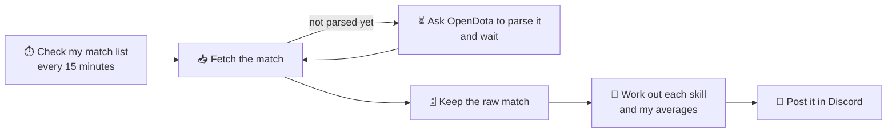

# 🏰 Guildhall

[](https://github.com/sid0494/guildhall/actions/workflows/ci.yml)


A gaming companion that lives in my Discord server. 🎮 It watches the games and
stores I use, then posts reports, tracks progress and sends alerts on its own,
and answers slash commands when I ask.

Each game is a separate module, so Guildhall can grow one game at a time.

> 🚧 **Status:** early development, not usable yet. Gank Report already finds,
> fetches and analyses matches; posting to Discord is next. See the
> [milestones](docs/design-spec.md#milestones) for what's coming and in what
> order.

## ⚔️ Gank Report: Dota 2

*Am I actually getting better at the things I'm practising?*

Rank moves slowly and depends on teammates. Gank Report instead tracks the 3–4
skills I've chosen to work on and compares every match with my own history on
the same hero.

- 🏁 **After every match**, a short report appears in Discord on its own: hero,
  result, and each skill I'm working on, marked against my recent average on
  that hero.
- 📈 **Every Sunday**, a weekly trend: each skill this week versus the previous
  four, plus my best and worst game of the week.
- ⚡ **Turbo is kept apart.** Ranked and unranked games are compared together;
  Turbo plays too differently, so it gets its own averages and its own weekly
  section.
- 🔗 **Linking my account** pulls in my recent matches, so trends work from day
  one.

Skills it can track include 🗡️ last hits at 10 minutes, 💰 gold per minute,
💀 deaths per 10 minutes, 💥 hero damage per minute and 👁️ observer wards
placed.

A post-match report looks roughly like this (example data):

```text
⚔️ Juggernaut · 🏆 Win · 41:12 · Ranked
   vs. my last 20 normal games on Juggernaut

   🗡️ Last hits at 10 min    62    ▲ better   (avg 54)
   💰 Gold per minute        612   ▲ better   (avg 571)
   💀 Deaths per 10 min      1.2   ▲ better   (avg 1.8)
   💥 Hero damage per min    498   ▼ worse    (avg 530)
```

How a match becomes a post:



## 🎒 Side Quest: Steam backlog and deals

*What should I play next, and is that game on my wishlist actually cheap right
now?*

- 📚 **Backlog tracking.** My Steam library is sorted into untouched, started,
  finished, dropped and on hold. It's guessed from playtime, and anything I
  set myself always wins.
- 🎲 **What to play.** `/next 2` suggests something from my backlog that fits in
  about two hours.
- 🏷️ **Sale alerts that mean something.** An alert only fires when a wishlisted
  game hits its all-time lowest price, or drops below a target price I set.
  The same deal never alerts twice; a deeper cut alerts once more.

## 💍 Rune Ledger: Elden Ring (planned)

A playthrough checklist the game doesn't have: bosses, Sites of Grace, NPC
questlines and key items, tracked separately for each playthrough. On Steam,
achievements tick off bosses automatically; everything else is a quick
command like `/done Margit`.

## 🤖 Commands

| Command | What it does |
| --- | --- |
| `/link dota` · `/link steam` | 🔗 Connect a Dota or Steam account |
| `/match last` | ⚔️ Report for my most recent match |
| `/trend [hero] [weeks]` | 📈 How my chosen skills have moved over time |
| `/focus add` · `/focus remove` | 🎯 Choose which skills to track |
| `/backlog [state]` | 📚 List games by backlog state |
| `/next [hours]` | 🎲 Suggest what to play |
| `/status <game> <state>` | ✅ Mark a game started, finished, dropped… |
| `/watch <game> [price]` | 🏷️ Alert me when a game drops below a price |
| `/guildhall status` | 🩺 Is everything running? |

## 🏗️ Built with


Every game is a plug-in on a shared platform that handles the hard parts once:
scheduling, queues, retries, rate limits, storage and Discord delivery. A broken
plug-in can't take the others down.

## 📚 More

- 🧭 [Design spec](docs/design-spec.md): how Guildhall works underneath.
- 🗳️ [Decision records](docs/adr/): why it's built the way it is.
- 🛠️ [Development](docs/development.md): running it and contributing changes.

## 📜 Licence

No licence is granted: all rights reserved. You're welcome to read the code
and learn from it.
