# Guildhall in diagrams

A visual tour of how Guildhall fits together, for anyone getting to know the
code. The [design spec](design-spec.md) is the source of truth and the
[decision records](adr/) say why; this page shows the shape of things and
links to both. Where the two disagree, the spec wins and this page is a bug.

Read it top to bottom: from the outside world, to where things run, to the
code, to how one piece of work flows through it.

1. [System context](#1-system-context)
2. [Where it runs](#2-where-it-runs)
3. [Inside a worker](#3-inside-a-worker)
4. [Code structure](#4-code-structure)
5. [Data model](#5-data-model)
6. [Workflows](#6-workflows)
7. [Lifecycles](#7-lifecycles)

**Legend**, used throughout:

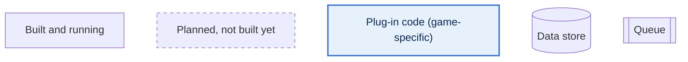

## 1. System context

Guildhall sits between a Discord server and the public game APIs. People only
ever talk to Discord; Guildhall answers their slash commands and posts reports
on its own.

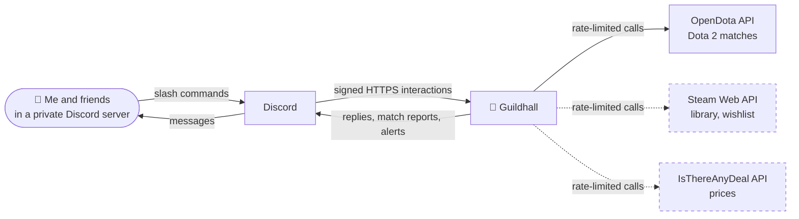

Steam and IsThereAnyDeal arrive with Side Quest (M5).

## 2. Where it runs

One container image runs everywhere. It has three entry points:
`guildhall-api` (the Discord endpoint), `guildhall-worker` (everything else)
and `guildhall-register-commands` (run by hand). Only the infrastructure
around it changes ([ADR 0024](adr/0024-container-image.md)).

| Piece | Local today (docker compose) | Local cluster (kind, M3) | AWS (EKS, M3) |
| --- | --- | --- | --- |
| api, worker | Containers | Deployments | Deployments |
| Job queue + dead-letter queue | moto (SQS emulator) | moto, in-cluster | SQS |
| Raw archive | moto (S3 emulator) | moto, in-cluster | S3 |
| Postgres | Container | In-cluster | RDS |
| Redis | Container | In-cluster | In-cluster |
| Schema and queue setup | One-shot `migrate` and `aws-setup` containers | Jobs | `migrate` Job; queues and bucket from Terraform |
| How Discord reaches the api | ngrok tunnel | ngrok tunnel | Load balancer with HTTPS |
| Secrets | `.env` (git-ignored) | Kubernetes Secret | Kubernetes Secret |

The kind and AWS columns are the current plan; the details are decided in M3
and recorded as they are.

### Local, today: docker compose

Everything runs on one machine. The `app` profile adds the bot's own
containers to the always-on infrastructure, and the `tunnel` profile adds
ngrok so Discord can reach the api
([ADR 0026](adr/0026-app-services-in-compose.md),
[ADR 0060](adr/0060-ngrok-tunnel.md)).

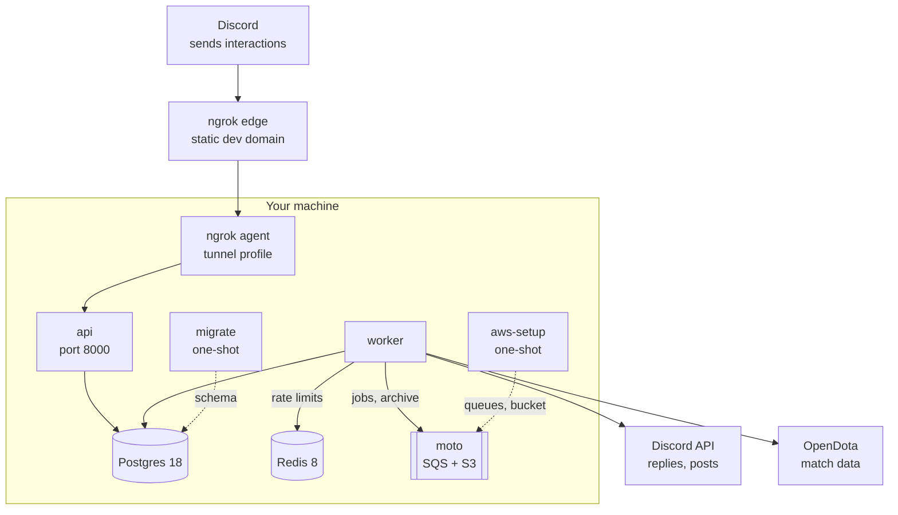

The ngrok agent dials out to ngrok's edge, so nothing on your machine is
opened to the internet; Discord's requests come back down that connection.
Posts, replies and OpenDota calls are outbound calls from the worker and need
no tunnel.
### On AWS (planned, M3)

The same image on EKS, with managed AWS services in place of the emulators.
Everything that bills by the hour is created and destroyed per session with
`make up` / `make down`
([spec: infrastructure](design-spec.md#infrastructure-and-deployment)).

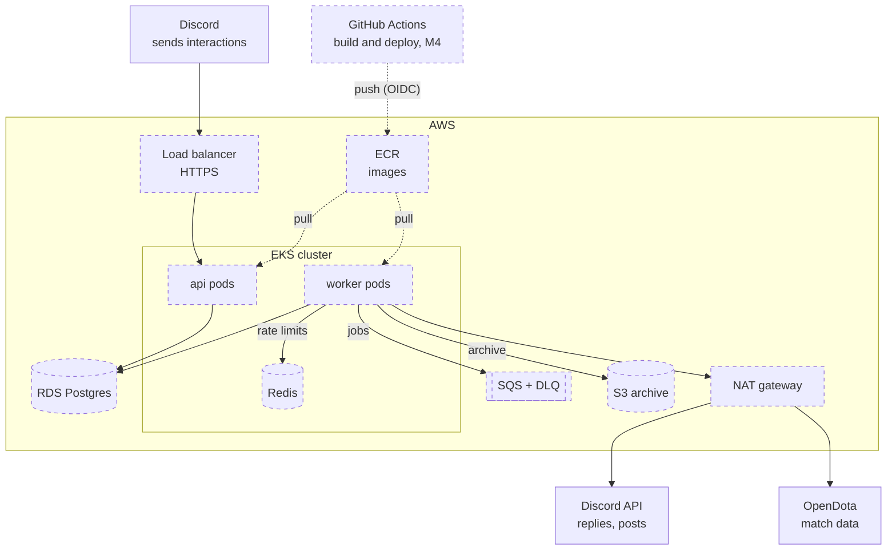

Everything sits in one VPC. Pods reach SQS and S3 through EKS Pod Identity,
so no AWS keys live in the cluster, and they reach the internet through the
NAT gateway. Kept between sessions: the S3 bucket, the Terraform state
bucket, the domain and an AWS Budgets alert, none of which bill by the hour.

## 3. Inside a worker

The worker is one Python process running several loops on one asyncio event
loop. The key idea is the **transactional outbox**: nothing talks to SQS or
Discord in the middle of a database transaction. Work that must happen later
is written to an `outbox_*` table in the same transaction as the change that
caused it, and a separate loop sends it afterwards. So a crash can delay a
message but never lose it or send it for a change that was rolled back
([ADR 0016](adr/0016-worker-job-lifecycle.md),
[ADR 0019](adr/0019-outbox-relay.md),
[ADR 0022](adr/0022-worker-loops.md)).

The two halves of a worker meet only in Postgres.

**Running a job.** A message comes in from SQS; the runner hands it to the
plug-in's handler and commits what the handler asked for.

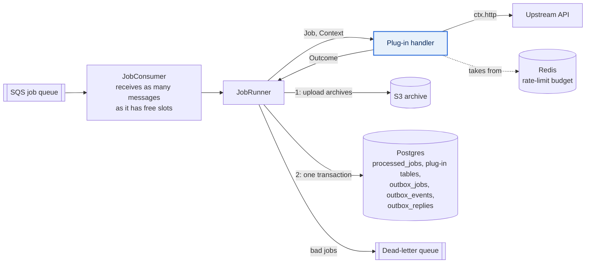

**Getting things out.** Separate loops read the outbox tables and deliver
what's there, then mark it sent.

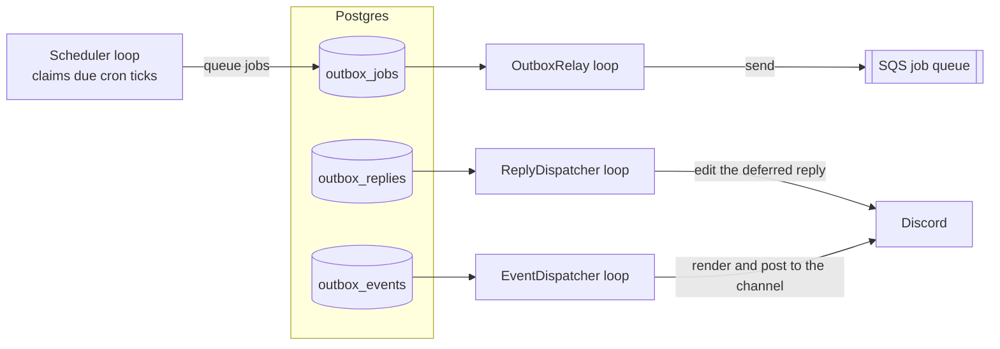

A prune loop also deletes settled outbox rows and old interaction IDs.

| Loop | What it does | Records |
| --- | --- | --- |
| Consumer + runner | Receive jobs, run the plug-in's handler, commit its outcome | [0018](adr/0018-job-runner.md), [0021](adr/0021-worker-concurrency.md) |
| Scheduler | Each interval, claim due cron ticks and queue their jobs | [0036](adr/0036-scheduling-in-workers-with-a-postgres-claim.md), [0037](adr/0037-missed-ticks-fire-once.md) |
| Relay | Send `outbox_jobs` rows to SQS | [0019](adr/0019-outbox-relay.md) |
| Reply dispatcher | Edit command replies into Discord | [0064](adr/0064-replies-through-an-outbox.md) |
| Event dispatcher | Render events and post them to the channel | [0072](adr/0072-posting-events-to-a-channel.md) |
| Prune | Delete sent outbox rows and old interaction IDs | [0061](adr/0061-interactions-endpoint-flow.md) |

Every loop that reads an outbox locks its batch with `FOR UPDATE SKIP
LOCKED`, so any number of worker replicas can run side by side without
handling the same row twice.

## 4. Code structure

### Packages

Dependencies point one way. Plug-ins see only the contract; the platform
implements it; `bootstrap` is the one place that wires concrete pieces
together ([ADR 0008](adr/0008-plugin-contract-shape.md)).

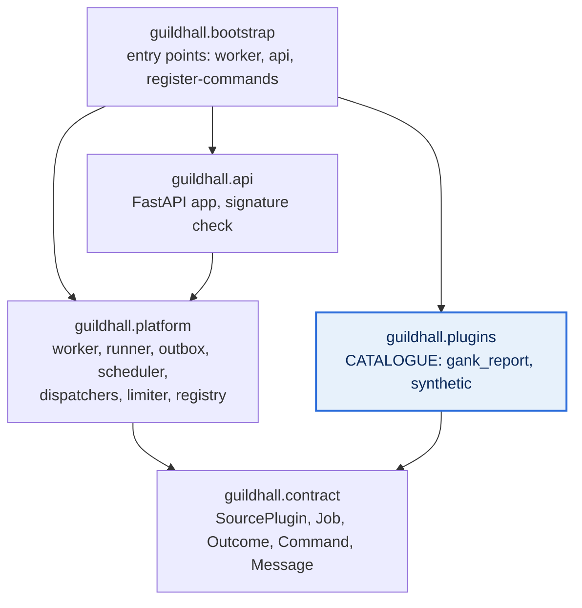

### The plug-in contract: jobs

A plug-in is a `SourcePlugin`. It declares job types, each a payload model
plus a handler. A handler gets a `Job` and a `Context` (its only doors to the
outside) and returns an `Outcome` that describes what should happen; the
platform makes it happen ([spec: plug-in contract](design-spec.md#plug-in-contract)).

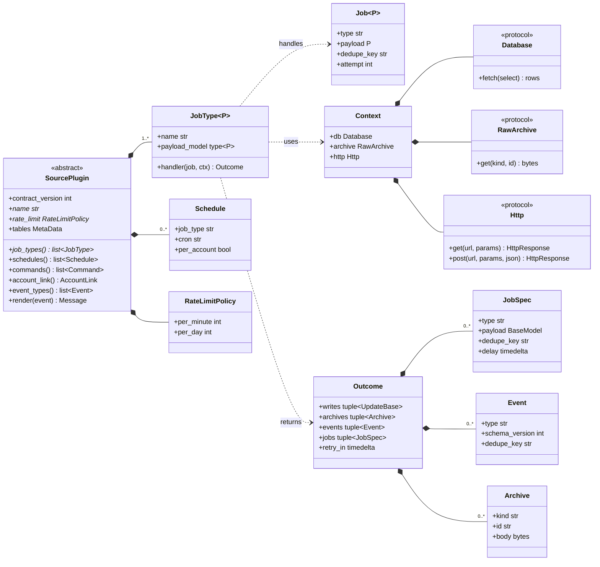

Members ending in `*` are abstract. `account_link()` and `render()` may
return `None`, and `retry_in` is set only when the work isn't ready yet, in
which case the outcome carries nothing else
([ADR 0028](adr/0028-plugin-writes-declared-in-the-outcome.md),
[ADR 0031](adr/0031-raw-archive-declared-in-the-outcome.md)).

### The plug-in contract: commands, links and messages

Slash commands and account links are declared the same way: a model for the
input and a handler. Replies and posts share one `Message` type
([ADR 0062](adr/0062-commands-in-the-contract.md),
[ADR 0066](adr/0066-the-platform-runs-link.md),
[ADR 0068](adr/0068-messages-with-embeds-and-mentions.md)).

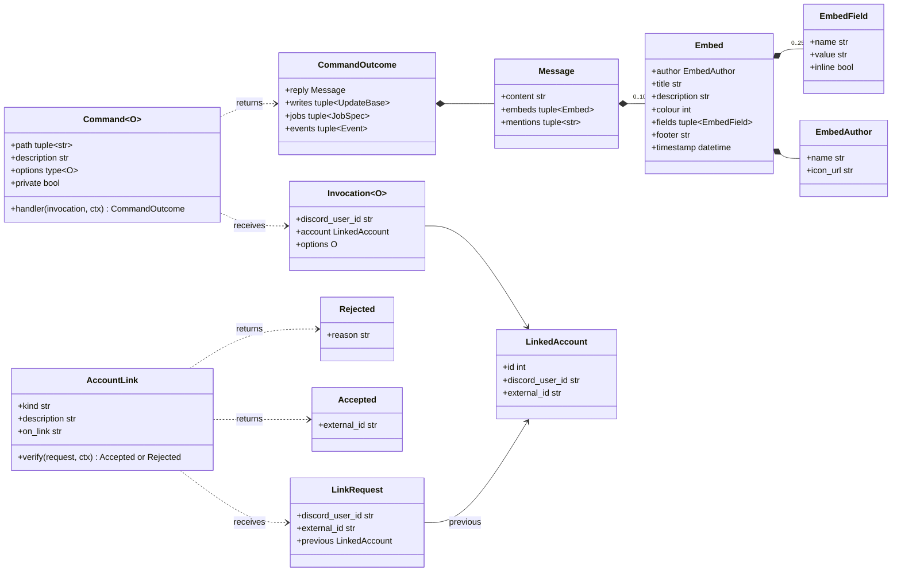

### The platform's main classes

How `bootstrap.run_worker` assembles a worker. Each class depends on small
protocols rather than on each other's concrete types, which is what lets the
unit tests swap in fakes.

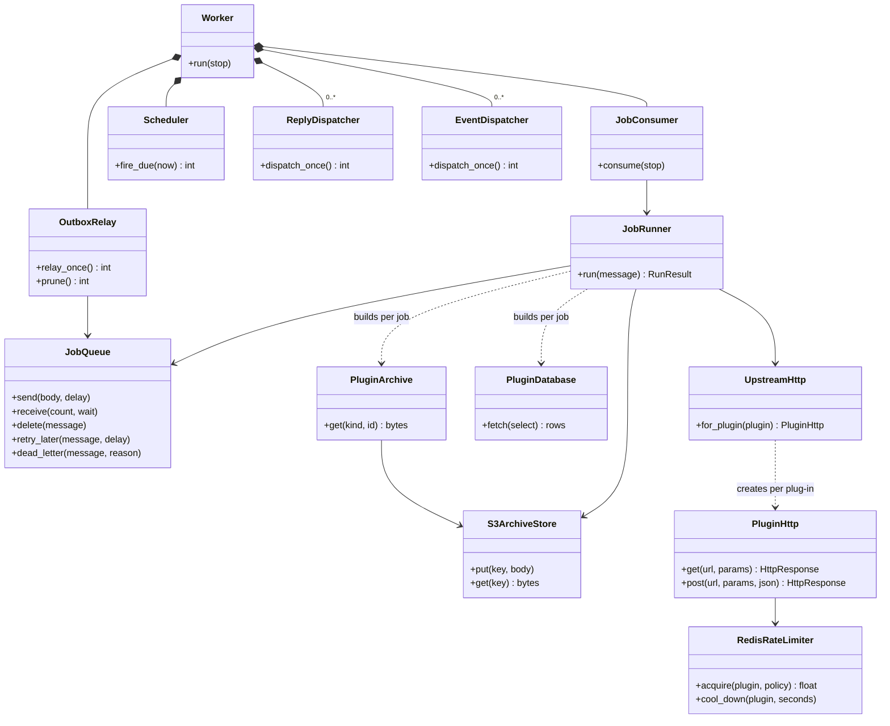

`PluginDatabase`, `PluginArchive` and `PluginHttp` are what a handler's
`Context` holds. Each is scoped to one plug-in: the database refuses tables
the plug-in doesn't own, the archive adds its `raw/<plug-in>/` prefix, and
the HTTP client takes from its own rate-limit budget
([ADR 0030](adr/0030-plugin-reads-through-a-checked-fetch.md),
[ADR 0034](adr/0034-shared-rate-limits-in-redis.md)).

### Gank Report

The first real plug-in. Its job types form the match pipeline; metrics are a
registry of small functions, so adding one needs no schema change
([ADR 0043](adr/0043-fetch-per-match-analyse-per-account.md),
[ADR 0053](adr/0053-metric-registry-and-missing-values.md)).

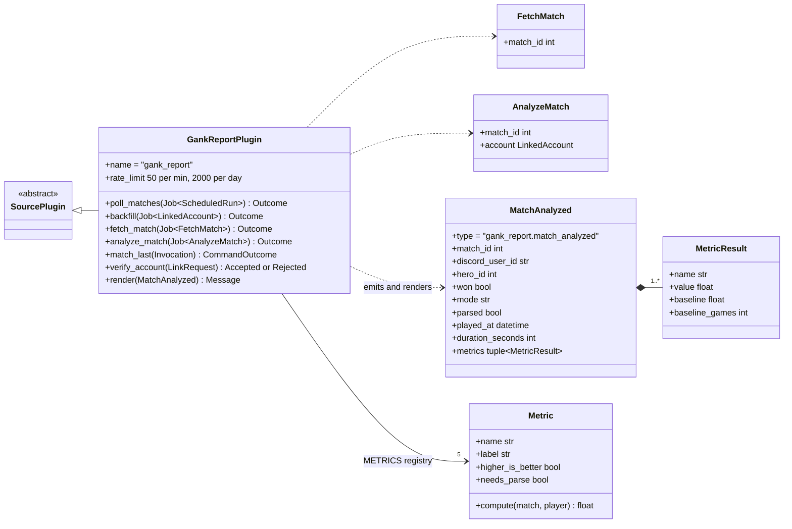

## 5. Data model

Platform tables are shared; each plug-in owns tables prefixed with its name
and can't touch anyone else's. In the diagrams, solid lines are foreign keys
and dotted lines match by value, with no foreign key
([spec: data model](design-spec.md#data-model)).

**Platform tables.** None of them join to another: each is a log or a queue,
keyed by its own ID or dedupe key. The first group records accounts and what
has already happened; the second holds work waiting to leave.

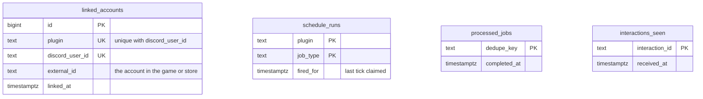

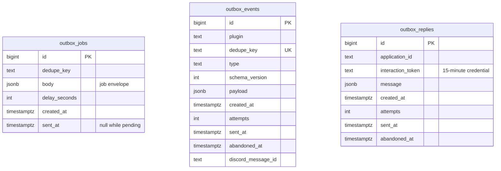

**Gank Report's tables.** One row per match, one per linked player in it, and
one per metric for that player, in long format so a new metric needs no
migration ([ADR 0045](adr/0045-gank-report-tables.md),
[ADR 0054](adr/0054-metrics-in-long-format.md)).

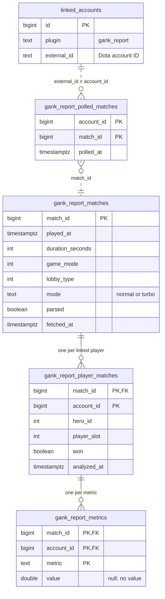

Planned tables (Gank Report's focus list; Side Quest's games, wishlist and
prices) are in the spec.

## 6. Workflows

Grey boxes in these diagrams are **database transactions**: everything inside
one commits together or not at all.

### A slash command, end to end

Discord gives a bot 3 seconds to answer. So the api answers "thinking..."
straight away and turns the command into a job; the worker runs the handler
and edits the real reply in afterwards
([ADR 0061](adr/0061-interactions-endpoint-flow.md),
[ADR 0063](adr/0063-commands-run-as-jobs.md),
[ADR 0064](adr/0064-replies-through-an-outbox.md)).

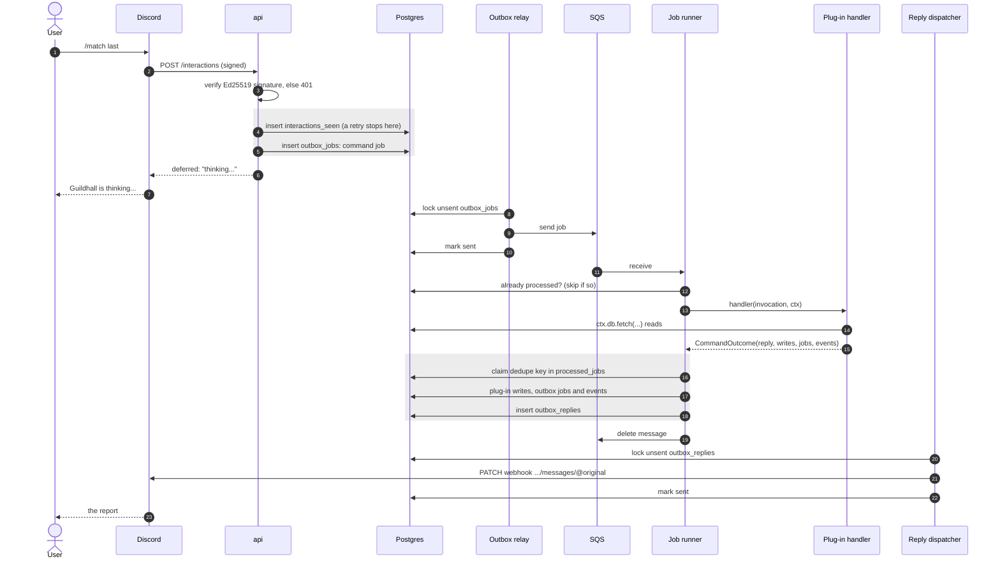

If the handler fails for good, the runner queues a generic "Something went
wrong" reply instead, so nobody is left looking at "thinking...". The api
never holds the bot token: the reply is edited in through the interaction's
own 15-minute token.

### From a played match to a post in Discord

No command involved: a schedule notices the match, and the pipeline fetches,
waits for the parse, archives, analyses and posts
([spec: match pipeline](design-spec.md#match-pipeline)). Each arrow into
SQS goes through `outbox_jobs` and the relay, as in the previous diagram;
it's drawn direct here to keep it readable.

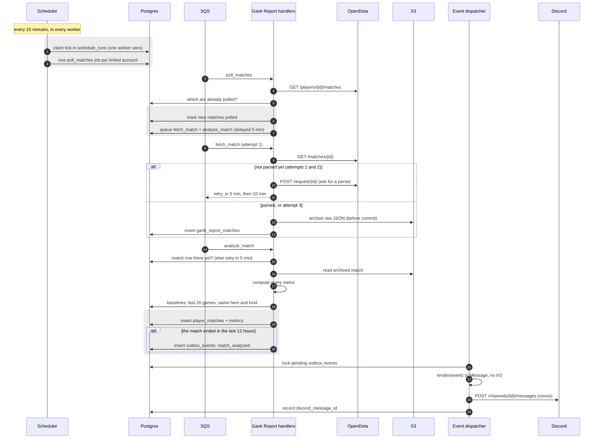

The handlers never call S3, Postgres writes or SQS themselves: they return
an `Outcome`, and the runner uploads its archives, then commits its writes,
jobs and events in one transaction. The arrows from "Gank Report handlers"
are drawn to where the effect lands.

### Linking an account

`/link` belongs to the platform; the plug-in only says whether an account is
valid. Accepting it stores the link, queues the backfill and queues the
reply in one transaction
([ADR 0066](adr/0066-the-platform-runs-link.md),
[ADR 0067](adr/0067-dota-links-and-the-backfill.md)).

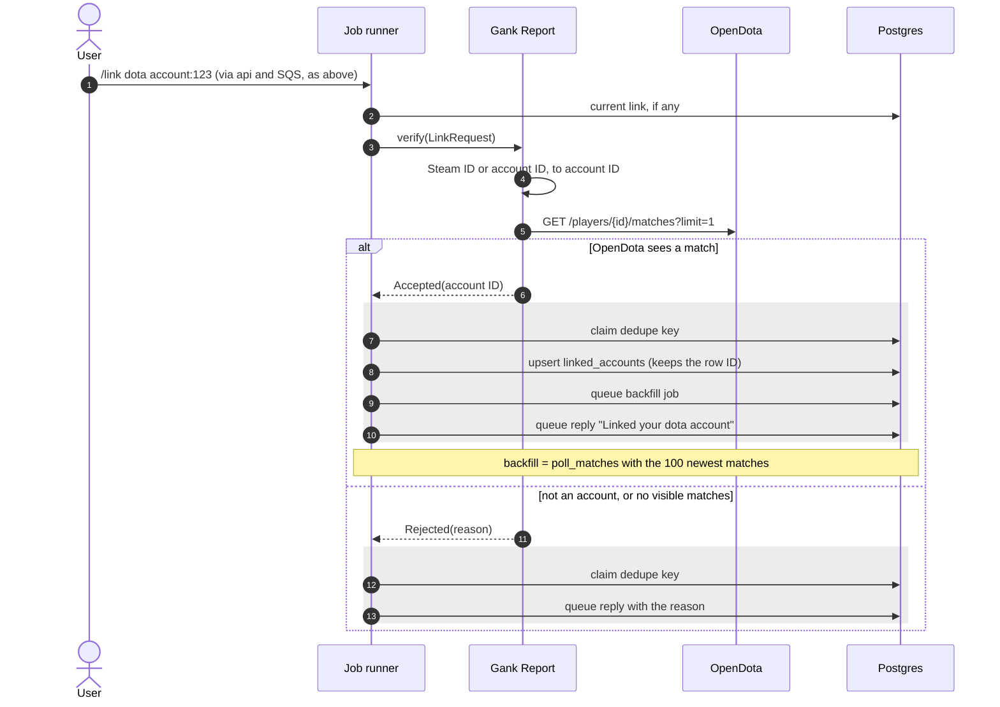

### What happens to a job message

Every message the runner receives ends in exactly one of these ways. The
plug-in signals which by what it returns or raises
([ADR 0018](adr/0018-job-runner.md),
[ADR 0033](adr/0033-throttled-jobs-are-deferred.md)).

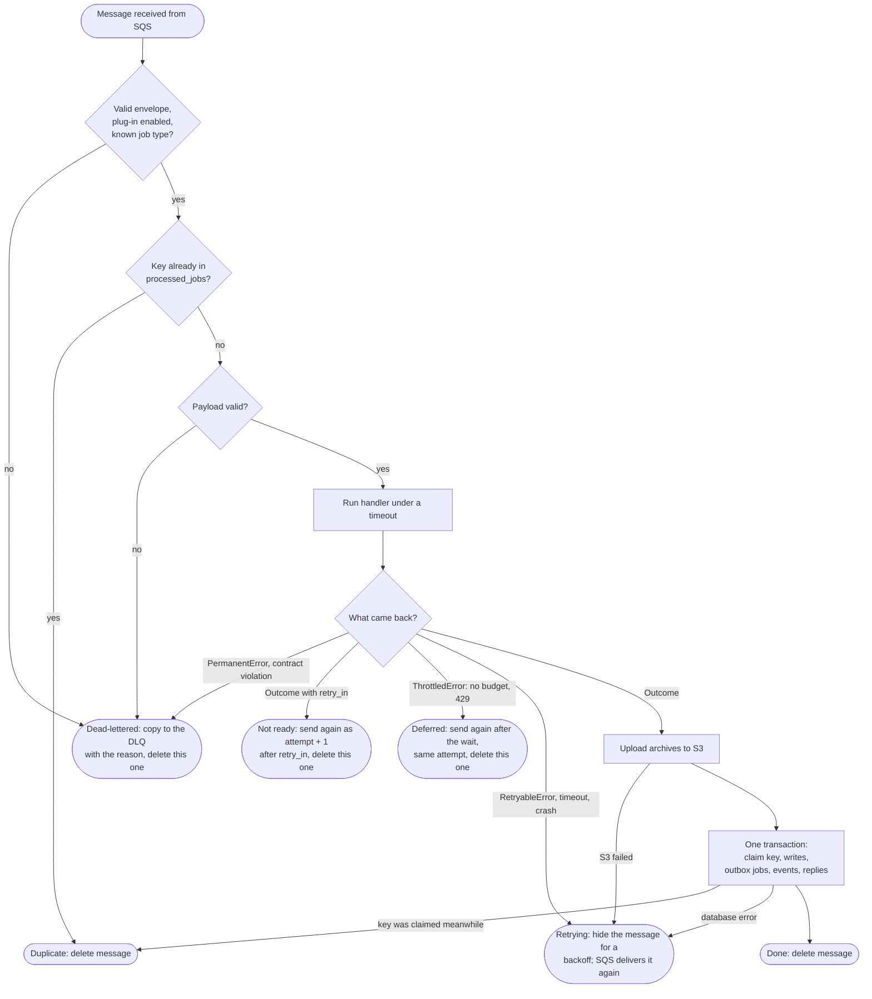

A retried message that SQS has delivered 5 times moves to the dead-letter
queue on its own, by the queue's redrive policy. Throttling and "not ready"
send a fresh message instead of retrying, so neither ever counts towards
that limit.

## 7. Lifecycles

### A match, per linked account

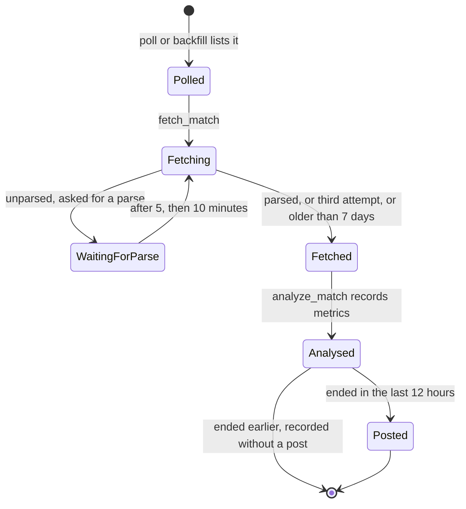

`analyze_match` is queued with the fetch and simply waits (checking every 5
minutes, for about two hours) until the match row exists
([ADR 0046](adr/0046-analysis-waits-for-the-fetch.md)).

### An outbox row (events and replies)

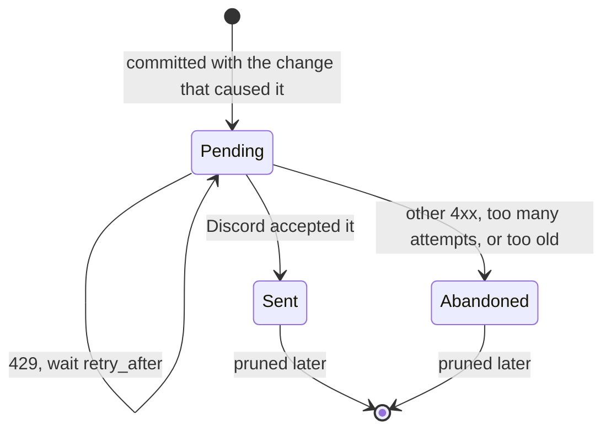

"Too old" is 14 minutes for a reply, since the interaction token expires at
15, and a day for an event, since a match report posted late is worse than
none ([ADR 0064](adr/0064-replies-through-an-outbox.md),
[ADR 0072](adr/0072-posting-events-to-a-channel.md)).
