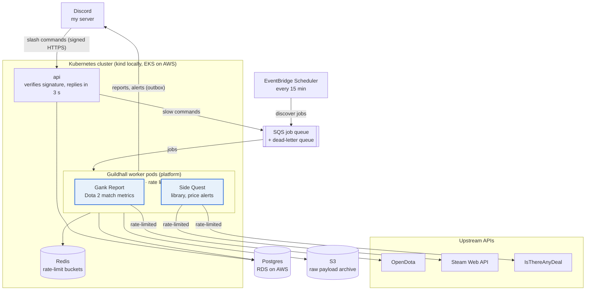

# Guildhall: Design Spec

Nov 7, 2026 · @sid0494

## Overview

Guildhall is a personal gaming companion that lives in Discord. It pulls data from the games and stores I use, turns it into reports, progress tracking and alerts, and answers slash commands. Each game or data source is a plug-in on a shared platform, so adding a new one never means rewriting the core.

| Plug-in | Game or source | What it does | Status |
| --- | --- | --- | --- |
| Gank Report | Dota 2 | Post-match skill reports and weekly trends on the skills I'm working on | First |
| Side Quest | Steam library and wishlist | Backlog tracking, what-to-play suggestions, sale alerts at real lows | Second |
| Rune Ledger | Elden Ring | Playthrough checklist: bosses, graces, questlines, key items | Later |

### Goals

- Track skill progress against my own history, not just rank.
- Keep the backlog honest: what I own, what I've started, what's worth buying and when.
- Make a new plug-in a self-contained piece of work behind one stable contract.
- Run reliably with no babysitting: retries, deduplication and upstream rate limits are handled by the platform.
- Run on containers locally and on AWS with infrastructure as code, cheaply.

### Non-goals

- Call of Duty: no official public stats API; the available wrappers need Activision login credentials and private endpoints.
- A web frontend. Discord is the interface.
- Real-time in-match data, overlays, or anything that touches the game client.
- Supporting many users. A few friends may link accounts later; the design shouldn't prevent it, but it isn't built for scale.

## Architecture

One container image runs as two Deployments: `api` handles Discord's signed requests and nothing slow; `worker` runs the platform loop that hosts the plug-ins. All slow work goes through SQS, so the api always answers Discord within 3 seconds.



The highlighted plug-ins are the only game-specific code; everything else is platform.

### Repository layout

```
guildhall/
  src/guildhall/
    bootstrap.py          composition root: wires the plug-in catalogue into the platform
    contract/             the plug-in contract: interface, job and event types, errors
    platform/             worker loop, dedupe, rate limiter, outbox, plug-in registry, logging
    plugins/gank_report/  discover, fetch_match, metrics, commands, render
    plugins/side_quest/   library and wishlist sync, prices, alerts, commands
    plugins/synthetic/    payload-driven plug-in for end-to-end tests, drills and load checks
    api/                  FastAPI app and the Discord interactions endpoint
  migrations/           Alembic
  compose.yaml          local infrastructure: Postgres, Redis, moto
  tests/                unit, contract and fixture tests; mock upstream server
  k8s/base/             Deployments, Services, Ingress, probes
  k8s/overlays/         local (kind) and aws (EKS)
  infra/                Terraform: VPC, EKS, ECR, RDS, SQS, S3, Scheduler
  docs/adr/             decision records
  .github/workflows/
  Makefile              up, down, test, drill
```

All Python code is one `guildhall` package in a src layout, so `guildhall.platform` never shadows the standard library's `platform` module ([ADR 0003](adr/0003-single-package-src-layout.md)).

**Stack:** Python 3.14 managed with uv ([ADR 0002](adr/0002-python-3-14-and-uv.md)), FastAPI, PostgreSQL through SQLAlchemy Core and psycopg 3 with Alembic migrations ([ADR 0013](adr/0013-database-access.md)), Redis, AWS SQS and S3, Docker, Kubernetes, Terraform, GitHub Actions.

## Plug-in contract

The platform owns everything cross-cutting: scheduling, queueing, retries, rate limiting, deduplication, storage and Discord delivery. A plug-in declares the kinds of jobs it handles; each handler does one piece of work and describes the result.

The contract lives in its own package, `guildhall.contract`. Plug-ins import from it and never from `guildhall.platform`, so dependencies point one way: plug-ins → contract ← platform ([ADR 0008](adr/0008-plugin-contract-shape.md)). Contract values are frozen pydantic models that ignore unknown fields ([ADR 0009](adr/0009-pydantic-contract-values.md)). In outline (the package is the source of truth):

```python
class SourcePlugin(ABC):
    contract_version: ClassVar[int] = 1  # bumped only on breaking changes
    name: str  # "gank_report", "side_quest"
    rate_limit: RateLimitPolicy  # per-minute and per-day budget for the upstream API

    @abstractmethod
    def job_types(self) -> list[JobType[Any]]:
        """Every kind of job, e.g. JobType("fetch_match", FetchMatch, self.fetch_match)."""

    def schedules(self) -> list[Schedule]:
        """Recurring triggers, e.g. Schedule(job_type="poll_matches", cron="*/15 * * * *")."""
        return []


# Every handler has the same shape:
async def fetch_match(self, job: Job[FetchMatch], ctx: Context) -> Outcome:
    """job.payload is already validated against FetchMatch.
    Return Outcome(events=..., jobs=...) when done, or Outcome(retry_in=...) when
    the work isn't ready yet. Raise RetryableError or PermanentError on failure."""
```

- `JobSpec` is work a handler asks for: type, payload, `dedupe_key` (e.g. `gank_report:match:8123456789`) and an optional delay. Any handler can return follow-up jobs, so polling is just a scheduled job type whose outcome is new jobs.
- `Outcome(retry_in=...)` is an expected wait, such as a match that isn't parsed yet. The job runs again with `attempt + 1` and it doesn't count as a failure; it emits nothing until it finishes.
- `Context` will carry the rate-limited HTTP client (`ctx.http`) and storage from M2. Discord commands (`commands()`) and rendering (`render()`, no I/O) join the contract in M2 as members with defaults, so existing plug-ins are unaffected.

### Rules

- Plug-ins never call Discord, SQS or each other, and import only `guildhall.contract`. They return jobs and events; the platform delivers them. A broken plug-in can't take down the bot.
- Every job and event has a `dedupe_key`, namespaced by plug-in name. The platform guarantees each key takes effect once.
- Errors are typed. `RetryableError` goes back on the queue with exponential backoff and jitter; `PermanentError` goes to the dead-letter queue with its reason. A payload that fails validation is dead-lettered before plug-in code runs. Handlers run under a timeout ([ADR 0018](adr/0018-job-runner.md)).
- Each plug-in has its own rate-limit bucket, so Side Quest checking prices can't eat Gank Report's OpenDota budget.
- Each plug-in owns its tables and never reads another plug-in's.
- Events carry `type` and `schema_version`. Within a version, changes are additive only; consumers ignore unknown fields.
- Available plug-ins are listed in one catalogue (`guildhall.plugins.CATALOGUE`); the enabled ones are named in `GUILDHALL_PLUGINS`. Disabling one is a config change, not a code change, and the platform refuses to start if a name is unknown ([ADR 0011](adr/0011-settings-and-plugin-catalogue.md)).
- The platform checks every plug-in's declarations at startup and every outcome at runtime (`guildhall.platform.checks`), with the same functions the contract suite uses ([ADR 0010](adr/0010-contract-enforcement.md)).

**Contract health check:** when a new plug-in needs a platform change, record why. Repeated changes in the same area mean the contract is missing a concept.

## Gank Report (Dota 2)

After each match, Gank Report posts a short report on the 3–4 skills I've chosen to work on. Every Sunday it posts the trend. The question it answers is "am I getting better at the things I'm practicing?", measured against my own history per hero.

**Data source:** the OpenDota API. Free, no key required, roughly 60 requests a minute and 2,000 a day on the free tier.

### Metrics

Some metrics need a replay-parsed match; the rest work from the basic match record.

| Metric | What it shows | Needs parsed match |
| --- | --- | --- |
| Last hits at 10 min | Laning and farming | Yes |
| GPM vs. my average on that hero | Farm efficiency | No |
| Deaths per 10 minutes | Positioning and risk | No |
| Hero damage per minute | Fight impact | No |
| Observer wards placed | Vision work as support | Yes |

Metrics live in a registry of small functions (`match_json → value or missing`), so adding one is a single function and no schema change. Comparisons use a rolling window (default: my last 20 games on that hero).

### Match pipeline

1. Every 15 minutes, a scheduled `poll_matches` job fetches my recent matches and returns one `fetch_match` job per new match ID, keyed `gank_report:match:<id>`.
2. `fetch_match` gets the full match and archives the raw JSON to S3.
3. If the match isn't parsed yet, it requests a parse and returns a retry outcome with a delay. Parsing usually takes 1–5 minutes, and some matches never parse.
4. After 3 attempts, it computes what it can from the basic record and marks parsed-only metrics as missing.
5. Metrics are written to Postgres and a `gank_report.match_analyzed` event goes to the outbox.

### Reports

- **Post-match:** hero, result, each focus metric with an arrow against my rolling average on that hero.
- **Weekly (Sunday):** per focus metric, this week vs. the previous four, plus the best and worst game of the week.
- **On demand:** `/match last` and `/trend [hero] [weeks]`.

### Backfill

Linking an account backfills the last 100 matches so trends work from day one. That burst is the main reason the rate limiter exists: steady use is only about 30 calls a day.

## Side Quest (Steam backlog and deals)

Side Quest turns my Steam library and wishlist into a managed backlog, suggests what to play next, and alerts me only when a wishlisted game is genuinely cheap.

**Data sources:** the Steam Web API for library, playtime and wishlist (needs a public profile and an API key); the IsThereAnyDeal API for prices across stores and historical lows (free key).

### Features

| Feature | How it works | Frequency |
| --- | --- | --- |
| Library sync | `GetOwnedGames` with total playtime per game | Daily |
| Wishlist sync | `IWishlistService/GetWishlist`; poorly documented, so pin the response shape with a recorded fixture | Daily |
| Backlog status | Inferred from playtime (under 30 min = untouched), overridden by `/status` | On sync |
| Price checks | Steam app ID → IsThereAnyDeal game ID (cached forever), then batched price and historical-low lookups | Twice daily |
| Sale alerts | Posted when a rule matches; see below | On price check |
| What to play | `/next [hours]` picks from untouched and started games | On demand |

### Backlog states

`untouched` → `started` → `finished`, with `dropped` and `on_hold` reachable from `started`. Inferred states never overwrite a state I set by hand (`status_source = manual`).

### Alert rules

An alert fires when the best current price for a wishlisted game is:

- at or below its historical low, or
- at or below my `/watch` target price.

Alerts are idempotent. The dedupe key is `side_quest:deal:<game>:<shop>:<price in cents>:<deal expiry date>`:

- The same deal seen on later checks produces the same key, so no repeat alert.
- A deeper cut is a new price, so a new key and exactly one new alert.
- The key is inserted under a unique constraint in the same transaction as the outbox event, so two workers seeing the deal at once still produce one alert.

Known gap: the same price returning months later with a different expiry date alerts again. That's acceptable; it is a new sale.

### What-to-play suggestions

Start simple: filter by state, rank untouched games by how long they've been owned, and use the hours argument to skip long games when a time estimate is available. Tuning this is optional, not core scope.

## Rune Ledger (Elden Ring, later)

A playthrough checklist the game doesn't have: bosses, Sites of Grace, NPC questlines, legendary items and key collectibles, tracked per playthrough so NG+ and separate PlayStation and Steam runs stay apart. This is a sketch to test the contract against, not a commitment.

**Data:** there is no API for player save data. Game reference data (bosses, items, locations) comes from the community Elden Ring Fan API, which was scraped from wikis and needs cleanup; its DLC coverage is unverified. Progress is logged by me through Discord, with Steam achievements auto-completing bosses and endings for the Steam run. Nothing is available for the PlayStation run beyond manual logging.

**What it would add to the platform:**

- A one-off `ingest` job for reference data, not a recurring poll. The contract's `schedules()` can return nothing; check that the platform handles that cleanly.
- Questline steps that depend on earlier steps: a small dependency graph per questline.
- Commands such as `/done Margit`, `/left Limgrave`, `/quest Ranni`.

If Rune Ledger fits without platform changes, the contract is in good shape.

## Discord interface

Guildhall uses Discord's HTTP interactions endpoint, not a persistent gateway connection. Slash commands arrive as signed HTTPS requests to the api, so the bot is a stateless endpoint behind the load balancer and scales like any other web service. A gateway bot would need one long-lived websocket with reconnects and session state.

### Commands

| Command | Plug-in | What it does |
| --- | --- | --- |
| `/link dota <account id>` | Gank Report | Links my Dota account and starts the backfill |
| `/link steam <steam id>` | Side Quest | Links Steam and runs the first sync |
| `/match last` | Gank Report | Report for the latest analyzed match |
| `/trend [hero] [weeks]` | Gank Report | Focus metrics over time |
| `/focus add\|remove <metric>` | Gank Report | Choose the skills to track |
| `/backlog [state]` | Side Quest | Lists games by state |
| `/next [hours]` | Side Quest | Suggests what to play |
| `/status <game> <state>` | Side Quest | Sets a game's state |
| `/watch <game> [max price]` | Side Quest | Adds a price target |
| `/guildhall status` | Platform | Queue depth, last run per plug-in, dead-letter count |

### Endpoint rules

- **Verify every request.** Check `X-Signature-Ed25519` against the timestamp plus the raw body with the app's public key; reject with `401` on failure. Answer `PING` with `PONG`; Discord uses it to validate the URL.
- **Respond within 3 seconds.** Slow commands return a deferred response at once and enqueue a job; the worker sends the real reply within 15 minutes. `/link` and `/trend` always take this path.
- **Deduplicate by interaction ID.** Discord can retry on network errors, so record the ID under a unique constraint before any side effect.
- **Proactive messages** (match reports, weekly trends, sale alerts) are not interactions. The outbox dispatcher posts them to a configured channel through the Discord API with the bot token.

Local development uses a tunnel (cloudflared or ngrok) so Discord can reach docker-compose.

## Data model

Platform tables are shared; each plug-in owns tables prefixed with its name. Raw upstream responses go to S3 under `raw/<plugin>/<kind>/<id>.json`, so a metric change means recomputing from the archive, not re-calling the APIs.

| Table | Owner | Key columns | Purpose |
| --- | --- | --- | --- |
| `linked_accounts` | Platform | `discord_user_id`, `plugin`, `external_id` | Who I am in each source |
| `processed_jobs` | Platform | `dedupe_key` (primary key), `completed_at` | A job key takes effect once |
| `outbox_events` | Platform | `id`, `plugin`, `dedupe_key` (unique), `type`, `schema_version`, `payload`; from M2 also `status`, `attempts`, `discord_message_id` | Events waiting for Discord delivery |
| `outbox_jobs` | Platform | `id`, `dedupe_key`, `body` (job envelope), `delay_seconds`, `sent_at` | Follow-up jobs waiting for the relay to send them to SQS ([ADR 0017](adr/0017-queue-client-and-outbox-tables.md)) |
| `interactions_seen` | Platform | `interaction_id` (primary key), `received_at` | Discord retry dedupe |
| `gank_report_matches` | Gank Report | `match_id`, `hero_id`, `played_at`, `parsed`, `s3_key` | One row per match |
| `gank_report_metrics` | Gank Report | `match_id`, `metric`, `value` | Long format, so new metrics need no migration |
| `gank_report_focus` | Gank Report | `discord_user_id`, `metric` | Chosen skills |
| `side_quest_games` | Side Quest | `appid`, `name`, `playtime_min`, `state`, `status_source` | Library and backlog state |
| `side_quest_wishlist` | Side Quest | `appid`, `itad_id`, `target_price_cents` | What to watch |
| `side_quest_prices` | Side Quest | `itad_id`, `shop`, `price_cents`, `history_low_cents`, `deal_expiry`, `captured_at` | Self-collected price history |

Money is integer cents plus a currency code; the price region is United States (USD). Timestamps are UTC; Discord renders them in local time.

## Platform guarantees

These are the promises the platform makes to every plug-in. Each one has a test.

| Guarantee | Mechanism |
| --- | --- |
| A job takes effect once, even if delivered twice | SQS is at-least-once; the worker records the job's `dedupe_key` in `processed_jobs` in the same transaction as the job's writes |
| A crashed worker loses no work | SQS visibility timeout redelivers unacknowledged messages; jobs must be safe to re-run |
| A follow-up job is never lost | Follow-up jobs go to `outbox_jobs` in the same transaction as the job's writes; a relay in each worker sends them to SQS, locking batches with `FOR UPDATE SKIP LOCKED` so replicas take different rows ([ADR 0016](adr/0016-worker-job-lifecycle.md), [ADR 0019](adr/0019-outbox-relay.md)) |
| Bad jobs don't block good ones | After 5 receives, a message moves to the dead-letter queue; permanent failures, invalid payloads, contract violations and disabled plug-ins go there at once with a reason; redrive after a fix |
| Upstream limits are respected across all replicas | One Redis token bucket per plug-in; `429` responses trigger exponential backoff with jitter |
| One event, one Discord message (almost) | Events go to `outbox_events` in the same transaction as the data change; the dispatcher posts and records `discord_message_id` |
| Discord retries don't double-act | `interactions_seen` with a unique constraint on the interaction ID |

### Two deliberate edge cases

- **Discord accepted the message but the dispatcher crashed before marking it sent.** The retry posts a duplicate. Avoiding it would need a delivery check against Discord on every retry; a rare duplicate message is the cheaper trade.
- **Redis is down.** The outbound limiter fails closed: workers pause jobs that call upstream APIs rather than risk exceeding someone else's limits. Commands that read only from Postgres keep working.

### Observability

- Structured JSON logs with `plugin`, `job_type`, `dedupe_key` and `attempt` on every line written while a job runs, plug-in and library lines included. structlog and standard `logging` share one processor chain; the job fields travel in context variables, so concurrent jobs never mix them up ([ADR 0020](adr/0020-structured-logging.md)).
- Metrics: jobs processed, failed and dead-lettered per plug-in; queue depth; upstream calls and `429`s per plug-in; outbox lag.
- `/guildhall status` in Discord surfaces the important ones without opening a dashboard.

## Infrastructure and deployment

One container image, three run targets. Everyday use runs locally; AWS runs the same image for cloud sessions.

| Environment | Compute | Queue and storage | Discord reaches it via |
| --- | --- | --- | --- |
| Dev | docker-compose | moto (SQS, S3), Postgres and Redis containers | Tunnel |
| Local cluster | kind with Kustomize `overlays/local` | Same, in-cluster | Tunnel |
| AWS | EKS with `overlays/aws` | SQS, S3, RDS Postgres; Redis in-cluster | ALB with HTTPS (own domain, ACM certificate) |

Locally, Docker Engine runs the services from `compose.yaml`: Postgres 18, Redis 8, and moto as an open-source emulator for SQS and S3. LocalStack was the first choice but now requires an account token, which CI and Dependabot pull requests cannot use ([ADR 0012](adr/0012-local-infrastructure.md)).

### AWS resources (Terraform)

- VPC with one NAT gateway, EKS with two small nodes, ECR repository
- RDS Postgres, smallest instance, no Multi-AZ
- SQS job queue plus dead-letter queue; S3 bucket for raw payloads
- EventBridge Scheduler for the recurring `discover` triggers
- IAM: pods get SQS and S3 access through EKS Pod Identity, no access keys in pods
- Terraform state in S3; an AWS Budgets alert

Redis stays in-cluster rather than ElastiCache: it only holds rate-limit buckets, which can be rebuilt, and it saves a managed service.

### Secrets

Discord public key and bot token, Steam API key, IsThereAnyDeal key. Configuration and secrets are environment variables prefixed `GUILDHALL_`, loaded with pydantic-settings and documented in `.env.example` ([ADR 0011](adr/0011-settings-and-plugin-catalogue.md)). Locally they come from a `.env` file that is never committed; in the cluster as a Kubernetes Secret created by `make up`. Moving them to AWS Secrets Manager is a later improvement.

### CI/CD (GitHub Actions)

- Every PR: the pre-commit hooks (lint, format, type check, unit tests, contract tests against the mock upstream), integration tests against the compose services, and a gitleaks scan of the full history; actions are pinned to commit SHAs ([ADR 0006](adr/0006-ci-workflow.md)).
- Dependabot: security fix PRs as advisories appear, and monthly grouped version updates for Python packages and actions after a 7-day cooldown ([ADR 0007](adr/0007-dependabot.md)).
- Merge to `main`: build the image, push to ECR tagged with the git SHA. AWS access through GitHub OIDC; no AWS keys stored in GitHub.
- Deploy: manually triggered workflow that sets the image tag and applies the AWS overlay.

### Cost guardrails

- EKS bills hourly even when idle (control plane $0.10 per cluster-hour on standard support; $0.60 once the Kubernetes version leaves standard support). Create and destroy per session with `make up` / `make down`, and pin a current version.
- Nodes, NAT gateway, load balancer and RDS also bill hourly; SQS, Scheduler and S3 are pay-per-use and negligible here.
- Destroy order: delete the Ingress first so the load balancer goes, then `terraform destroy`, then check the console. Keep the S3 bucket and domain.
- After an AWS session, point Discord's interactions URL back at the tunnel.

## Testing and failure drills

### Test layers

- **Unit:** metric functions, alert rules, state transitions, signature verification.
- **Integration:** code that depends on Postgres behaviour (constraints, transactions, locking) runs against the compose services, in a separate `guildhall_test` database, marked `integration`. Pre-commit skips them; CI runs them in their own job ([ADR 0015](adr/0015-integration-tests-on-compose.md)).
- **Contract tests:** a shared suite every plug-in must pass, run against a fake platform: declarations are valid, every job type has examples, payloads survive a JSON round trip, outcomes are namespaced, errors are typed, and (from M2) `render` does no I/O. A guard test fails if a plug-in has no examples.
- **Recorded fixtures:** real upstream responses (a parsed match, an unparsed match, a wishlist, a price batch) saved once and replayed, so tests never call live APIs.
- **Mock upstream server:** a small service in the cluster that can return `429`s, slow responses, never-parsed matches and malformed payloads on demand. All drills point at it.
- **Synthetic plug-in:** a plug-in whose job payload says what to do (sleep, wait, fail, crash, fan out, emit events). Disabled by default; enabled for end-to-end tests, drills and the load check.

### Failure drills

Run on the kind cluster. For each, record what was expected, what happened, and what changed.

| Drill | How to run it | Expected result |
| --- | --- | --- |
| Backfill burst | Link an account with 200 past matches | Outbound calls stay under 60 a minute across all worker replicas |
| Upstream 429 storm | Mock returns `429` for 2 minutes | Jobs back off and resume; none dead-lettered |
| Parse never finishes | Mock match stays unparsed | Basic metrics after 3 attempts; parsed-only metrics marked missing |
| Worker crash mid-job | Kill a worker pod holding jobs | Jobs redelivered after visibility timeout; no duplicate posts |
| Poison message | Enqueue a malformed job | Dead-lettered after 5 receives; redrive works after the fix |
| Same deal seen twice | Two price checks see one sale | Exactly one alert |
| Discord retry | Replay an interaction with the same ID | Handled once |
| Forged request | Interaction with a bad signature | `401`, nothing processed |
| Slow command | Make `/trend` take 5 seconds | Deferred reply arrives; no Discord timeout |
| Broken plug-in | Every Side Quest job throws | Gank Report unaffected; Side Quest jobs dead-lettered |
| Redis down | Scale Redis to 0 | Upstream-calling jobs pause; read-only commands still answer |
| Postgres down | Scale Postgres to 0 for 60 seconds | Readiness probes pull pods; recovery without manual steps |

### Load check

Enqueue 1,000 synthetic plug-in jobs on kind and record throughput per worker replica, while confirming no plug-in exceeds its upstream budget.

## Milestones

Milestones are defined by what works, not by dates. Each ends with a usable system.

### M0: Setup

- [x] Steam profile and game details set to public; Steam Web API key
- [x] IsThereAnyDeal API key
- [x] Discord application and a private test server
- [x] Repo with the layout above, pre-commit hooks, CI skeleton

### M1: Platform skeleton

- [ ] Plug-in contract, registry and contract test suite
- [ ] Worker loop with dedupe, typed errors and dead-letter handling
- [ ] docker-compose with api, worker, Postgres, Redis, moto

**Done when:** a fake plug-in's jobs flow end to end and a duplicate delivery is a no-op.

### M2: Gank Report, local

- [ ] `discover`, `fetch_match`, parse-retry, S3 archive, metric registry
- [ ] Per-plug-in rate limiter with backoff
- [ ] Discord endpoint, `/link`, `/match last`, outbox dispatcher

**Done when:** I play a match and the report shows up in Discord on its own.

### M3: Kubernetes and AWS

- [ ] kind manifests with probes and limits
- [ ] Terraform for the AWS resources; `make up` / `make down`
- [ ] Discord pointed at the cluster over HTTPS

**Done when:** Gank Report runs end to end on EKS, and a destroy leaves nothing billing.

### M4: Delivery pipeline and Gank Report complete

- [ ] GitHub Actions build, push and manual deploy with OIDC
- [ ] `/trend`, `/focus`, weekly report, 100-match backfill

**Done when:** a merge ships a new image and the Sunday report posts.

### M5: Side Quest

- [ ] Library and wishlist sync, backlog states
- [ ] Price checks, alert rules with dedupe keys
- [ ] `/backlog`, `/next`, `/status`, `/watch`

**Done when:** Side Quest ships with no platform changes, or each change it needed is recorded with its reason.

### M6: Hardening

- [ ] All failure drills run and recorded
- [ ] Load check
- [ ] README with quickstart and architecture
- [ ] Rune Ledger fit check against the contract

### Later

- Rune Ledger
- Autoscale workers on queue depth (KEDA)
- Friends linking accounts, scoped per Discord server
- Secrets in AWS Secrets Manager; CloudWatch dashboards and alarms

## Decisions and open questions

Each decision gets a short record in `docs/adr/` (context, options, choice, consequences) when it is made. Small design calls count too; they're the ones most easily forgotten. Records are numbered in the order they are written; see [ADR 0001](adr/0001-record-architecture-decisions.md).

### Decisions to record

Pending decisions have no number until their record is written; the ADR column then links to it.

| Decision | Current leaning | ADR |
| --- | --- | --- |
| Plug-in contract shape and what the platform owns | ABC with declared job types, own package | [0008](adr/0008-plugin-contract-shape.md) |
| HTTP interactions endpoint vs. gateway bot | HTTP endpoint | Pending |
| Job dedupe in Postgres vs. SQS FIFO deduplication | Postgres `processed_jobs` (works with standard queues and outlives FIFO's dedupe window) | [0014](adr/0014-job-dedupe-in-postgres.md) |
| Side Quest alert dedupe key | Game, shop, price, deal expiry | Pending |
| Outbound limiter fails closed when Redis is down | Fail closed | Pending |
| Redis in-cluster vs. ElastiCache | In-cluster | Pending |
| Accept rare duplicate Discord posts on dispatcher crash | Accept | Pending |
| Metrics stored long format vs. one column per metric | Long format | Pending |

### Open questions

- [ ] Which 3–4 Gank Report metrics matter most for how I actually play? Try for two weeks, then prune.
- [ ] Is the rolling window of 20 games per hero right, given how often I repeat heroes?
- [ ] Does `GetWishlist` return enough to skip a separate store lookup? Check against a recorded response.
- [ ] Where do time-to-beat estimates for `/next [hours]` come from, if anywhere?
- [ ] Should weekly reports be skipped in weeks with fewer than 3 matches?

## References

Rate limits and prices change; confirm against the official pages before relying on a number.

- [OpenDota API overview and rate limits](https://jentic.com/apis/opendota.com/opendota)
- [OpenDota parse requests](https://glama.ai/mcp/servers/hkaanengin/opendota-mcp-server/tools/request_parse_match)
- [Steam Web API (Valve Developer Community)](https://developer.valvesoftware.com/wiki/Steam_Web_API)
- [Steam GetOwnedGames and GetWishlist usage notes](https://github.com/mdeguzis/proton-pulse-web/wiki/Steam-Library-and-Drafts)
- [IsThereAnyDeal API documentation](https://docs.isthereanydeal.com/)
- [Discord HTTP interactions: signatures and the 3-second rule](https://www.codehooks.io/docs/examples/webhooks/discord)
- [HTTP interactions vs. gateway tradeoffs](https://playcode.io/blog/how-to-create-a-discord-bot)
- [Elden Ring Fan API](https://docs-eldenring-api-git-fork-julesferreira-fix-sc-773c82-deliton.vercel.app/docs)
- [Amazon EKS pricing summary](https://geekchamp.com/?p=1072184)
